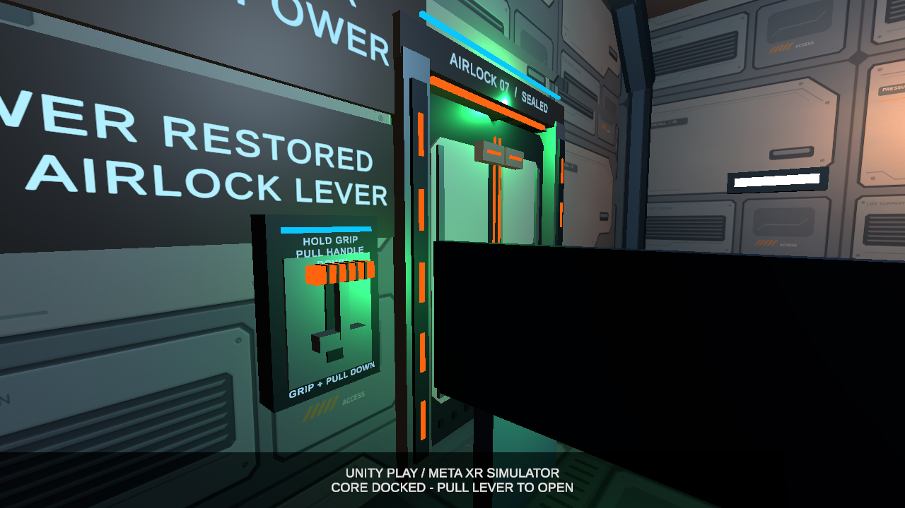
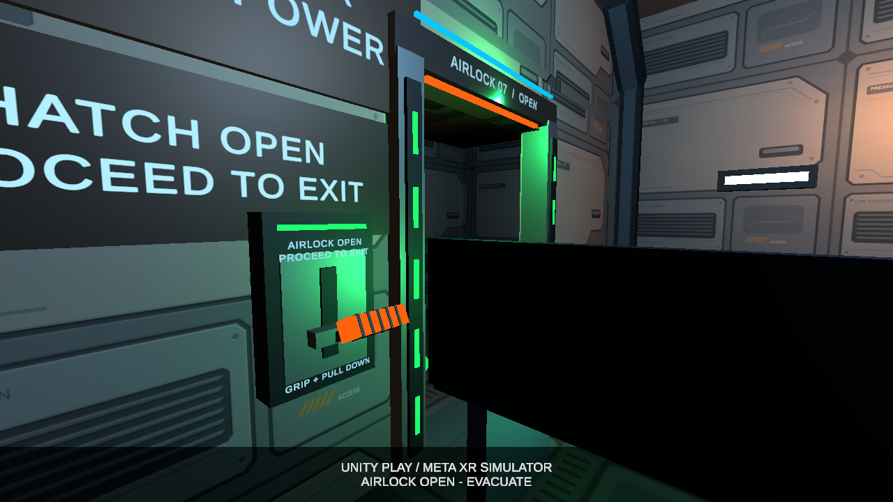
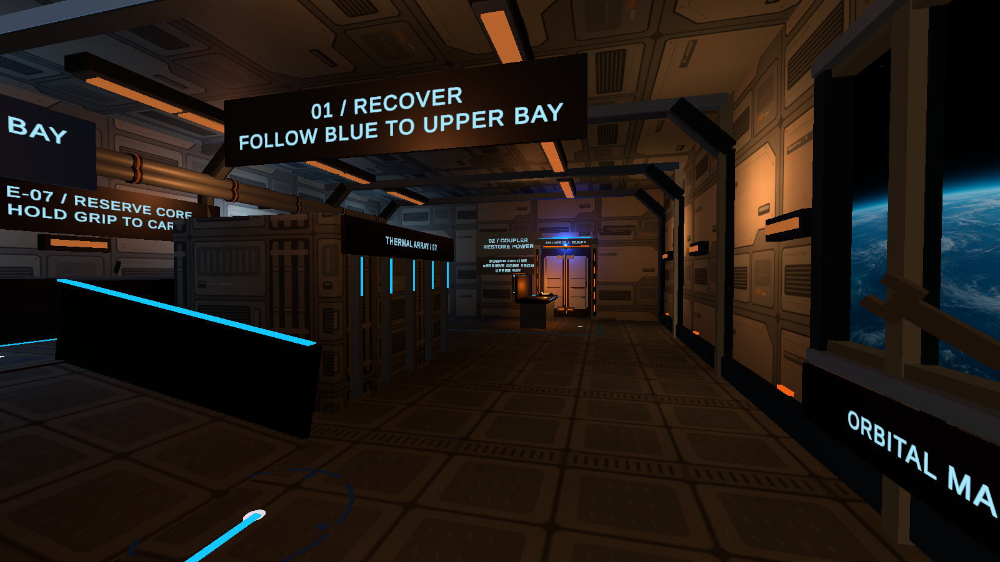
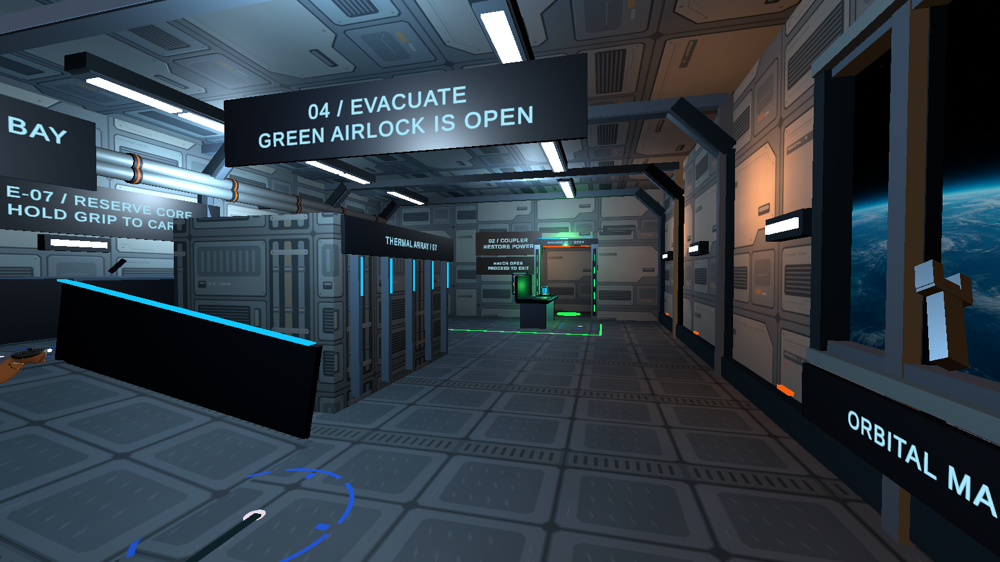

# Before/after · Movement, task feedback and airlock interaction

Baseline: Week 09 recovery route, version 0.5.0. Current submission: version 0.6.0, 11 November 2026.

## Movement and recoverability

Previously, the route used ground movement and teleportation. The current scene adds a small upward boost, airborne steering, and an explicit brake/settle input. A and X are shown in the control panel and in an entrance instruction sign. The configured gravity factor is 0.10 and target maximum lift is 0.20 m. Teleportation, snap turning, the help menu, and reset remain available. Opening the menu, losing input focus, or teleporting cancels active floating motion.

The core initially rests on the supply bench. After it has been grabbed and released, it drifts slowly and can be grabbed again. A soft return force begins outside 0.28 m from its release anchor; this is not a hard positional boundary. Docking or reset stops floating.

## Power state and next-action instructions

In the Week 09 baseline, core insertion initiated restoration and automatic hatch opening. In the current version, restoration leaves the hatch closed. During recovery the status reads `POWER LINKING / WAIT FOR LEVER LIGHT`; once power is ready, the panel directs the player to Grip and pull the handle. A partial pull returns to rest. A held pull reaching 55 degrees starts the existing double-door animation; the indicator and text then show `AIRLOCK OPEN / PROCEED TO EXIT`.

The added interaction makes power restoration and door release two separate player actions. Color is accompanied by text, handle position, door movement and audio feedback. Their effectiveness and reach accessibility across users still require observation.

**Power restored; lever ready, hatch still closed:**

**Lever pulled and hatch open:**

## Environmental feedback from one viewpoint

The emergency-to-restored lighting sequence was introduced in Week 09 and is retained in the current prototype. These current-version images illustrate the two mission states; they are not a performance comparison or a new lighting optimization claim.

**Before repair: emergency power.**

**After repair and lever activation: restored power and evacuation route.**

All four images are actual Unity Play captures with Meta XR Simulator and scripted input from the saved validation run. They are not Quest Camera recordings.

## Checks performed and still required

The automated evidence covers movement interruption, boost height, repeated grab/release, power-to-lever gating, partial pull return, opening, exit, and reset while the lever is held or the hatch is moving. The developer separately reported a Quest 2 Link/Air Link self-trial without discomfort.

A first-use session with another adult remains planned. It will check whether the starting instructions are understood, text is readable, the lever can be reached and grabbed, the brake is discoverable, and the power-to-lever dependency is clear. Record hesitation, help requests and discomfort, revise the main observed issue, then repeat the same task. No peer-test results or measured accessibility improvement are claimed in this submission.
